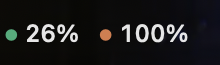
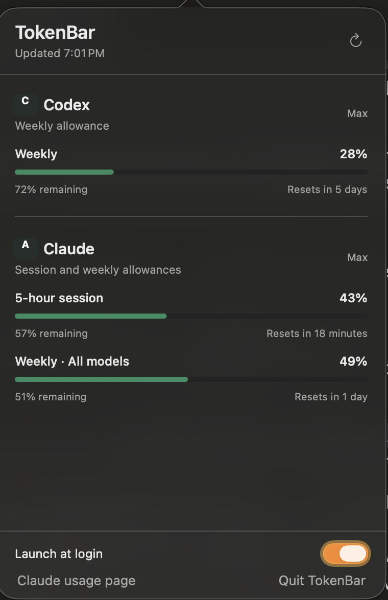

<h1 align="center">TokenBar</h1>

<p align="center">
  Codex and Claude usage, always visible in your Mac menu bar.
</p>

<p align="center">
  
</p>

<p align="center">
  Native macOS app. No browser tab, account dashboard, or manual tracking.
</p>

## What you get

<table>
  <tr>
    <td width="46%" align="center">
      
    </td>
    <td width="54%">
      <strong>Always available</strong><br>
      See both providers from one compact menu-bar item.<br><br>
      <strong>The limits that matter</strong><br>
      Codex weekly usage plus Claude's five-hour session and weekly allowances.<br><br>
      <strong>Useful reset information</strong><br>
      View remaining allowance and the next reset time at a glance.<br><br>
      <strong>Quiet by design</strong><br>
      TokenBar has no Dock icon and can launch automatically when you sign in.
    </td>
  </tr>
</table>

## Install

### Requirements

- macOS 14 or newer
- [Apple Command Line Tools](#apple-command-line-tools)
- Codex CLI installed and signed in
- Claude Code installed and signed in

### Build and open TokenBar

```bash
git clone https://github.com/Prajwal-ak-0/tokenbar.git
cd tokenbar
bash scripts/test.sh
bash scripts/package_app.sh
ditto dist/TokenBar.app /Applications/TokenBar.app
open /Applications/TokenBar.app
```

TokenBar appears in the menu bar and registers itself to launch at login. If Claude is not connected, open TokenBar and select **Connect Claude**. Claude Code owns the browser sign-in and stores its credential in macOS Keychain.

<details>
  <summary id="apple-command-line-tools">Installing Apple Command Line Tools</summary>

  Run:

  ```bash
  xcode-select --install
  ```

  Complete Apple's installer, then run the TokenBar build commands again.
</details>

## Privacy and request safety

TokenBar is intentionally conservative with credentials and provider requests.

| Protection | Behavior |
| --- | --- |
| Credentials | Read from the providers' existing local sign-in state, held only in memory, and never written by TokenBar |
| Claude polling | At most one Anthropic usage attempt every 5 minutes; repeated Refresh clicks share cached data |
| Rate limits | HTTP 429 responses trigger persistent 5–30 minute exponential backoff and respect numeric or HTTP-date `Retry-After`, including longer server delays |
| Offline behavior | The last successful Claude response remains available during rate limits and temporary network failures |
| Local cache | Stored as JSON data in macOS preferences; no access token is included |

## How it works

### Codex

TokenBar queries the local Codex app server through `account/rateLimits/read` and selects its weekly quota window.

### Claude

TokenBar reads the existing Claude Code OAuth credential from macOS Keychain and requests usage from Anthropic's authenticated Claude usage endpoint. Background and ordinary Refresh reads prohibit Keychain interaction with the process-wide legacy interaction switch, an explicit UI-fail query policy, and a noninteractive authentication context. **Authorize Claude access** is a separate manual action if permission is unavailable; only that action temporarily enables TokenBar's Keychain permission dialog. Token expiry and HTTP 401/403 are distinguished from missing credentials, so an access problem does not automatically request a new browser login. For an expired token, open Claude Code to renew its own credential, then click **Refresh**. TokenBar never launches Claude Code from background checks or ordinary Refresh, and never exchanges Claude Code's rotating refresh token. This avoids provider-owned Keychain prompts escaping TokenBar's no-dialog controls. This endpoint is not a documented public API and may change; TokenBar uses conservative polling, persistent caching, and rate-limit backoff to avoid unnecessary traffic.

### Refresh and recovery

Each provider shows the age of its own measurement. Hover for the exact capture time; cached values keep their original timestamp. Percentages preserve fractional values, and Claude's plan is derived from its credential instead of assuming Max. Reset countdowns are computed locally; a passed reset triggers a fresh measurement when eligible and never invents a zero-percent value.

Automatic checks adapt to interaction: every 5 minutes for an hour after opening the panel, every 15 minutes for the following three hours, and every 30 minutes when idle longer, during idle Low Power Mode, or under serious thermal pressure. Recent panel interaction retains the five-minute cadence in Low Power Mode. Opening the panel checks eligible data immediately. UI countdowns update locally every 15 seconds without provider requests. Persisted cooldowns take priority over resets, manual Refresh, app restarts and adaptive scheduling.

Model-specific limits are available behind a disclosure below Claude's primary rows; the disclosure turns amber when an additional limit reaches 75%. Settings, including **Launch at Login** and **Quit TokenBar**, live in the gear menu. TokenBar allows one running instance per app bundle identifier; separate monitors such as CodexBar have their own polling schedules.

A freshly built app may need a new macOS Keychain grant. Claude Code can also rotate or recreate its Keychain item. If silent access is no longer available, TokenBar retains the last measurement and shows **Authorize Claude access**, rather than requesting your password during automatic checks. Choosing that explicit action can still require your Mac login password. Enter that password only in macOS's own dialog; TokenBar does not collect it.

## Updating

```bash
cd tokenbar
git pull
bash scripts/test.sh
bash scripts/package_app.sh
pkill -x TokenBar || true
ditto dist/TokenBar.app /Applications/TokenBar.app
open /Applications/TokenBar.app
```

## Troubleshooting

| Problem | What to do |
| --- | --- |
| TokenBar is not visible | Run `open /Applications/TokenBar.app` |
| Claude has no saved sign-in | Select **Connect Claude**; only this action starts browser sign-in |
| Claude Keychain access is unavailable | Select **Authorize Claude access** to grant the installed app access; if macOS asks for your password, enter it yourself |
| Claude session expired | Open Claude Code to renew the session, then click **Refresh**; Refresh itself does not launch any authentication helper |
| Claude returns HTTP 403 | Check account permissions on the Claude usage page; repeated sign-in is not assumed to fix it |
| Claude is rate limited | Wait until the displayed next check; manual Refresh and restarts preserve the cooldown |
| Multiple usage monitors are running | Keep one Claude monitor active to avoid polling the same endpoint from multiple apps |
| Usage looks stale | Check Claude’s capture age, next-check time and any error below the bars; `~` in the menu bar marks stale Claude data |
| TokenBar is in the wrong position | Hold Command and drag it to the preferred menu-bar position |
| The build fails after moving the project | Remove `.build`, then run `bash scripts/package_app.sh` again |

## Development

Run the parser and Claude service regression tests (synthetic credentials, an injected clock, in-memory preferences and stubbed responses; no real Keychain or API calls):

```bash
bash scripts/test.sh
```

Build an ad-hoc signed application:

```bash
bash scripts/package_app.sh
```

The generated application is written to `dist/TokenBar.app`.

## Design references

The panel uses native AppKit vibrancy, system typography and SF Symbols. Provider SVG marks come from [CodexBar](https://github.com/steipete/CodexBar), with its MIT notice included in `Resources/ProviderIcons-LICENSE.txt` and the packaged app. Refresh behavior was compared with CodexBar's [refresh-loop documentation](https://github.com/steipete/CodexBar/blob/main/docs/refresh-loop.md); TokenBar retains a five-minute Claude floor even during recent interaction.

## Project status

TokenBar is an independent personal project. It is not affiliated with or endorsed by OpenAI or Anthropic.
